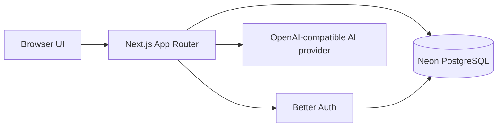

# Thinkwell

Thinkwell is an account-based AI chat application for conversations, image generation, and saved chat history. The web app combines a Next.js interface and server-side API routes with Better Auth, Neon PostgreSQL, and configurable OpenAI-compatible AI endpoints.

**Live app:** [thinkwell-ai-chat.vercel.app](https://thinkwell-ai-chat.vercel.app)

## Contents

- [Features](#features)
- [Technology](#technology)
- [Architecture](#architecture)
- [Project structure](#project-structure)
- [Requirements](#requirements)
- [Local setup](#local-setup)
- [Environment variables](#environment-variables)
- [Database setup](#database-setup)
- [Run and build](#run-and-build)
- [API routes](#api-routes)
- [Authentication](#authentication)
- [Testing](#testing)
- [Deployment](#deployment)
- [Security and data handling](#security-and-data-handling)
- [Known limitations](#known-limitations)
- [Contributing](#contributing)

## Features

- Email and password accounts, plus Google and GitHub sign-in when provider credentials are configured.
- Streaming AI chat responses from a configurable OpenAI-compatible chat-completions API.
- Image generation through a configurable image API endpoint.
- Per-account conversation and message history stored in PostgreSQL.
- Search conversations by title; rename, pin, archive, restore, copy a private conversation link, and delete conversations.
- Copy, regenerate, listen to, and rate assistant responses.
- Browser speech recognition for voice input, and image download.
- Light and dark appearance settings, plus profile name and password updates.

## Technology

| Area | Technology |
| --- | --- |
| Web app and server routes | Next.js App Router 16, React 19, TypeScript |
| Authentication | Better Auth |
| Database access | Drizzle ORM with the Neon serverless PostgreSQL driver |
| AI chat and images | OpenAI-compatible HTTP APIs; provider and model are configured through environment variables |
| Hosting configuration | Next.js Node.js runtime; `scripts/run-next.mjs` respects the hosting platform's `PORT` on production start |

## Architecture

The browser renders the chat interface and calls same-origin Next.js route handlers. The server checks the signed-in session, reads and writes account data through Drizzle, and calls the configured AI provider for chat or image generation.



## Project structure

```text
src/
  app/
    api/
      auth/[...all]/       Better Auth handlers
      chat/                Streaming chat endpoint
      chat/feedback/       Assistant response ratings
      chat/history/        Conversation and message history
      image/               Image generation endpoint
      config/              AI key readiness endpoint
    page.tsx               Session-aware app entry point
  components/
    chat-app.tsx           Signed-in chat interface
    sign-in.tsx            Email, Google, and GitHub sign-in UI
  lib/
    auth.ts                Better Auth and provider configuration
    auth-client.ts         Browser auth client
    db.ts                  Neon and Drizzle connection
    schema.ts              Drizzle table definitions
    ai-config.ts           AI key validation
schema.sql                 Complete SQL setup for a new database
drizzle/                  Drizzle migration files and metadata
scripts/run-next.mjs       Next.js launcher
.env.example               Safe environment variable template
```

## Requirements

- Node.js 22.15 or newer (as specified by `package.json`).
- npm.
- A Neon PostgreSQL database.
- An API key for an AI provider compatible with the app's chat and image endpoints if you want to use AI features.
- OAuth credentials for Google and/or GitHub if you want those sign-in options.

The project uses Next.js route handlers for its backend; there is no separate backend service to start.

## Local setup

Clone the repository, install the locked dependencies, and create a local environment file:

```bash
git clone https://github.com/updymalikally/Thinkwell-ai-chat.git
cd Thinkwell-ai-chat
npm ci
cp .env.example .env.local
```

In PowerShell, use this command to copy the template:

```powershell
Copy-Item .env.example .env.local
```

Edit `.env.local` and set at least `DATABASE_URL` and `BETTER_AUTH_SECRET`. Configure AI and OAuth values for the features you want to use. Follow [Environment variables](#environment-variables) and [Database setup](#database-setup), then start the development server:

```bash
npm run dev
```

Open [http://localhost:3001](http://localhost:3001). Create an account or use a configured social sign-in provider.

New email/password accounts must use a password 8–128 characters long with at least one uppercase letter, one lowercase letter, one number, and one of these special characters: `@ $ ! % * ? & #`.

## Environment variables

The safe template is [`.env.example`](.env.example). Copy it to `.env.local` for local work. Add production values in your hosting provider's environment settings; do not commit `.env.local` or real credentials.

| Variable | Required | Description |
| --- | --- | --- |
| `DATABASE_URL` | Yes | Neon PostgreSQL connection string used by the application and Drizzle. |
| `BETTER_AUTH_SECRET` | Yes | Private, strong secret used by Better Auth. Use a unique value per environment; the example placeholder is not suitable for deployment. |
| `BETTER_AUTH_URL` | Deployment | Application origin, such as `https://your-domain.example`. The local default is `http://localhost:3001`; set the deployed HTTPS origin in production. |
| `GOOGLE_CLIENT_ID` | Optional | Google OAuth client ID. Required only to enable Google sign-in. |
| `GOOGLE_CLIENT_SECRET` | Optional | Google OAuth client secret. Required only to enable Google sign-in. |
| `GITHUB_CLIENT_ID` | Optional | GitHub OAuth app client ID. Required only to enable GitHub sign-in. |
| `GITHUB_CLIENT_SECRET` | Optional | GitHub OAuth app client secret. Required only to enable GitHub sign-in. |
| `OPENAI_API_KEY` | For AI features | Server-side API key for the selected AI provider. The example configuration uses OpenRouter. |
| `OPENAI_BASE_URL` | Optional | Base URL for the AI API. Chat defaults to `https://api.openai.com/v1`; image generation defaults to `https://openrouter.ai/api/v1`. Set this explicitly when your provider needs a particular base URL. |
| `OPENAI_MODEL` | Optional | Chat model identifier. The code default is `gpt-4o-mini`; `.env.example` provides an OpenRouter-style model ID. |
| `OPENAI_MODELS` | Optional | Comma-separated chat model IDs to offer in the model picker. The configured `OPENAI_MODEL` is always included. |
| `OPENAI_IMAGE_MODEL` | Optional | Image model identifier. The code default is `bytedance-seed/seedream-4.5`. |

Model identifiers, endpoint compatibility, available image models, and pricing depend on the provider and account. The app sends chat requests to `<OPENAI_BASE_URL>/chat/completions` and image requests to `<OPENAI_BASE_URL>/images`; choose a provider that supports the endpoint you intend to use.

## Database setup

For a new database, run [`schema.sql`](schema.sql) once in the Neon SQL Editor. It creates the authentication, conversation, message, AI usage, and feedback tables and indexes used by the application. Then set `DATABASE_URL` in `.env.local` to that database's connection string.

The repository also contains Drizzle migration scripts (`npm run db:generate` and `npm run db:migrate`). The checked-in migration history is not a complete bootstrap for an empty current database. Use `schema.sql` for a fresh setup; do not run the checked-in migrations against a database initialized from that file without first reconciling the migration history. Back up existing data before applying schema changes.

## Run and build

| Command | Purpose |
| --- | --- |
| `npm run dev` | Start Next.js in development mode on port 3001. |
| `npm run build` | Create an optimized production build. |
| `npm start` | Start the production server on the platform-provided `PORT`, or port 3001 locally. |
| `npm run db:generate` | Generate Drizzle migration files from the current schema. |
| `npm run db:migrate` | Apply pending Drizzle migrations using `DATABASE_URL`. |

The database configuration reads `.env.local` when loading Drizzle configuration. For production, provide `DATABASE_URL` through the host's environment settings.

## API routes

All routes are same-origin Next.js route handlers. Chat, image, history, and feedback operations require a signed-in session and enforce per-user ownership where applicable.

| Route | Method | Purpose |
| --- | --- | --- |
| `/api/auth/[...all]` | `GET`, `POST` | Better Auth email/password, OAuth, session, and account handlers. |
| `/api/chat` | `POST` | Validates chat input, streams the AI response, and stores the user and assistant messages. |
| `/api/image` | `POST` | Generates an image from a prompt and returns it as a data URL. |
| `/api/chat/history` | `GET` | Lists up to 100 recent conversations; `?id=<conversation-id>` loads one conversation's messages. |
| `/api/chat/history/[id]` | `PATCH`, `DELETE` | Renames or deletes a conversation owned by the signed-in user. |
| `/api/chat/feedback` | `POST` | Adds, changes, or clears a rating for the signed-in user's assistant message. |
| `/api/config` | `GET` | Returns whether an AI API key is configured. |

The chat and image routes return authentication, validation, ownership, and upstream provider errors as HTTP responses. Chat responses are streamed as server-sent events from the configured provider.

## Authentication

Better Auth stores users, sessions, provider accounts, and verification records in the configured PostgreSQL database. Email/password sign-up is enabled. Google and GitHub OAuth are configured in `src/lib/auth.ts` and require their respective client credentials.

For each OAuth application, register the exact callback URL for the environment:

```text
Google: https://<your-domain>/api/auth/callback/google
GitHub: https://<your-domain>/api/auth/callback/github
```

For local development, replace the origin with `http://localhost:3001`. Configure production and local OAuth callback URLs in the corresponding provider consoles. Never expose client secrets in browser code or public repositories.

## Testing

There is no automated test or lint script in `package.json`. `npm run build` is the available production compilation command; it is not a substitute for an automated test suite.

## Deployment

The app can run on a Next.js-compatible Node.js host. The project is connected to Vercel; when GitHub deployments are enabled in project settings, pushes to the configured branch can trigger a deployment.

Before deploying:

1. Create a Neon PostgreSQL database and initialize it with [`schema.sql`](schema.sql), or use a migration workflow after reconciling the checked-in migration history.
2. Add `DATABASE_URL`, a strong `BETTER_AUTH_SECRET`, and `BETTER_AUTH_URL` for the deployed HTTPS origin to the host's Production environment.
3. Add the Google and/or GitHub OAuth credentials if those sign-in methods should be available, and register each production callback URL with its provider.
4. Add `OPENAI_API_KEY` and configure the AI base URL and model identifiers for the provider and features you intend to use.
5. Build with `npm run build` and start with `npm start`, or use the host's standard Next.js deployment integration.

For this deployment, the application origin is `https://thinkwell-ai-chat.vercel.app`; its OAuth callbacks are `/api/auth/callback/google` and `/api/auth/callback/github`.

## Security and data handling

- Keep `.env.local` and production credentials private. `.gitignore` excludes local environment files; `.env.example` contains placeholders.
- Use a strong, unique `BETTER_AUTH_SECRET` and the exact HTTPS `BETTER_AUTH_URL` in production.
- API routes check the current session and scope conversation operations to the signed-in user's account.
- Copying a conversation link does not make it public. The application still checks account ownership when the link is opened.
- Chat prompts and image descriptions are sent to the configured AI provider. Review that provider's privacy, retention, and billing terms.
- OAuth client secrets and AI API keys are read server-side and should not be placed in client-side code.

## Known limitations

- Pin, archive, and appearance preferences are stored in browser local storage and do not sync across browsers or devices.
- Copied conversation links work only for the account that owns the conversation.
- Generated image data is returned to the browser for display and download; the database stores the prompt and a text response, not the image file itself.
- AI model availability and image endpoint support vary by provider and account.

## Contributing

There is no project-specific contribution guide in the repository. Keep proposed changes focused, preserve the existing per-user authorization checks, and do not commit credentials. Include a concise summary and any checks you ran when submitting a pull request.
